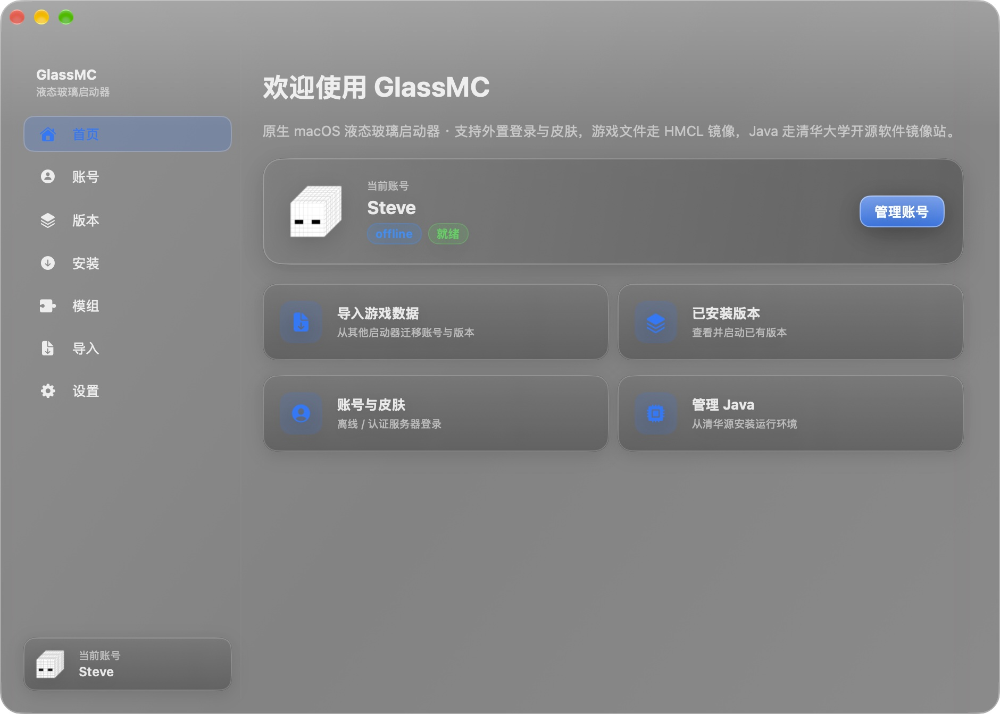

# GlassMC

**一个长在 macOS 上的 Minecraft 启动器。** 液态玻璃界面，装版本、装模组、开游戏，一条龙。

[](https://github.com/shaun-chen2/GlassMC/releases/latest/download/GlassMC.dmg)
[](https://shaun-chen2.github.io/GlassMC/)



---

## 这是什么

GlassMC 是一个用原生 Swift 写的 macOS 启动器，界面是整块「液态玻璃」——半透明、跟着窗口一起呼吸，不是套壳网页。

它做的事情很朴素：**把「装游戏」这件事变成三次点击**。

- 选一个版本 → 点安装 → 它自己下游戏、下资源、下 Java；
- 想玩模组 → 在模组页搜，点一下就装好了；
- 手上已有整合包 → 直接拖进来导；
- 以前用 HMCL/N 年前的老启动器 → 一键把账号和版本搬过来。

---

## 下载安装

**系统要求**：Apple Silicon（M1 及以上）· macOS 15 Sequoia 或更新

1. 点上面的 **下载 GlassMC.dmg**（或到 [介绍页](https://shaun-chen2.github.io/GlassMC/) 下载）；
2. 打开 dmg，把 **GlassMC** 拖进「应用程序」；
3. 第一次打开会被 macOS 拦一下——因为这是一个没有 Apple 开发者签名的应用，属于正常现象。

### 首次打开被拦？两种解法，选一个

**方法一（图形界面，推荐）**

1. 双击 GlassMC，弹窗提示「无法打开，因为 Apple 无法验证此 App 是否包含恶意软件」，点 **完成**；
2. 打开 **系统设置 → 隐私与安全性**，向下滚到「安全性」区域；
3. 会看到一行 *"GlassMC" 已被阻止使用…*，点 **仍要打开**，输入开机密码；
4. 再双击 GlassMC，这次弹窗里有 **打开** 按钮，点它。以后就不会再拦了。

**方法二（一行命令，最快）**

打开「终端」，粘贴回车：

```bash
xattr -dr com.apple.quarantine /Applications/GlassMC.app
```

> 这条命令只是去掉 macOS 给下载文件打的「待检查」标记，不改动应用本身。
> 如果 GlassMC 没装在「应用程序」里，把路径换成实际位置。

---

## 三分钟上手

### 1. 先登录

左侧 **账号** → 右上角 **添加账号**，三种方式任选：

| 方式 | 适合谁 | 说明 |
| --- | --- | --- |
| **离线账号** | 单机 / 自建服 | 只填个名字，立刻可用 |
| **微软正版** | 有正版账号 | 设备码登录，浏览器里输 6 位码即可，不用填密码 |
| **认证服务器** | 皮肤站用户 | 内置 LittleSkin、Ely.by、MiniSkins，也可填自建地址 |

登录后账号卡片会显示你的 3D 皮肤头像；皮肤站账号会自动同步站点上的皮肤。

### 2. 装一个版本

左侧 **安装** → 「游戏版本」页签里挑一个版本 → 点 **安装**。

- 默认只列正式版，勾选「显示快照版」能看到快照；
- 游戏文件走国内镜像（BMCLAPI），速度比官方源快很多；
- 如果本机还没装 Java，它会顺手把合适的 JDK 从清华镜像装好，不用你操心。

想玩模组？切到「模组加载器」页签，选 **Fabric / Quilt / NeoForge / Forge** 和目标游戏版本，点安装，它会依次装好游戏本体和加载器。

### 3. 装模组

左侧 **模组**：

- **在线搜索**：输入关键词（支持中文），从 Modrinth 搜索，选好版本点安装；
- **已装模组**：看到每个模组的名称、版本、大小，可以随时 **禁用 / 删除**；
- **整合包**：把 `.mrpack` 拖进来导入，也可以把当前实例导出成整合包分享给别人。

### 4. 启动

左侧 **版本** → 选实例 → 点 **启动**。日志实时滚在窗口里，出问题一眼能看见。

---

## 功能一览

| 能力 | 说明 |
| --- | --- |
| **全版本覆盖** | 正式版 + 快照，2010 年至今的版本都能装 |
| **加载器一键装** | Fabric / Quilt / NeoForge / Forge，自动匹配游戏版本 |
| **版本隔离** | 每个实例独立的 mods / 存档 / 配置，互不打架 |
| **模组管理** | Modrinth 在线搜索、装 / 禁 / 删、缺失依赖提示 |
| **整合包** | `.mrpack` 双向支持：导入、导出 |
| **多模式账号** | 离线 / 微软正版设备码登录 / 任意 Yggdrasil 皮肤站 |
| **皮肤同步** | 认证服务器皮肤自动带进游戏（authlib-injector） |
| **皮肤库** | 内置皮肤库，在线挑一张直接套用 |
| **Java 托管** | 清华镜像装 JDK 8 / 11 / 17 / 21，自动识别系统已有 JDK |
| **内存分配** | 滑块给内存，按机器配置推荐 |
| **进阶参数** | 自定义 JVM 参数、窗口尺寸、一键导出启动脚本 |
| **数据迁移** | 扫描并导入 HMCL、官方启动器、Prism/MultiMC 的账号与版本 |
| **液态玻璃** | 整窗通透玻璃材质，透明度 0.35 ~ 1.0 可调 |

---

## 数据放在哪

所有东西都在一个目录里，想备份/清理直接动它：

```
~/Library/Application Support/GlassMC/
├── minecraft/     游戏本体、模组、存档、资源
├── java/          启动器装的 JDK
├── skins/         皮肤缓存
└── accounts.json  账号
```

从别的启动器导入时，GlassMC 只是**读取**对方目录再复制过来，不会改动原启动器。

---

## 常见问题

**Q：提示「GlassMC 已损坏，无法打开」怎么办？**
去 **系统设置 → 隐私与安全性 → 安全性**，找到 `"GlassMC" 已被阻止使用…` 那一行，点 **仍要打开**，输入开机密码；再双击一次 GlassMC，弹窗里点 **打开** 即可。具体步骤见上面「首次打开被拦？」。如果那里始终没有这一行，再用方法二的 `xattr` 命令；仍然不行就说明 dmg 没下完整，重新下载一次（2 MB 左右）。

**Q：启动报 Java 相关错误？**
到 **设置 → Java** 页面看看有没有可用的运行时。没有就点安装，选 17 或 21（1.17 以上版本用 17/21，1.16 以下用 8）。也可以在导入实例时选择「使用实例自带的 Java」。

**Q：内存给多少合适？**
8 GB 内存的机器给 4 GB，16 GB 给 6~8 GB，加了大量模组的整合包给 8~12 GB。别把全部内存都给游戏，系统会卡。

**Q：皮肤站登录了，但游戏里皮肤是默认的？**
确认启动的实例用的是那个皮肤站账号；外置登录会在启动时自动注入 `authlib-injector`，日志里能看到 `Authentication server: <你的皮肤站地址>`。看不到就重启一次启动器再启动。

**Q：加了模组进不去游戏？**
看窗口里的日志，最常见的是缺前置模组或版本区间不匹配。模组页的「已装模组」会标出缺失依赖；也可以先用「禁用」逐个排查。

**Q：Intel Mac 能用吗？**
目前只提供 Apple Silicon 版本。

---

## 关于这个项目

- 界面与逻辑全部为原生 Swift / SwiftUI，不使用网页技术；
- 游戏文件来自 BMCLAPI 镜像，Java 来自清华大学开源软件镜像站；
- 模组数据来自 [Modrinth](https://modrinth.com)；
- 本项目与 Mojang / Microsoft 无关联，需要自备正版账号才能连接正版服务器。

想自己编译：`bash build.sh`（需要 macOS 15 + Command Line Tools），产物在 `build/GlassMC.app` 与 `GlassMC.dmg`。

以 [MIT 许可](LICENSE) 开源。
